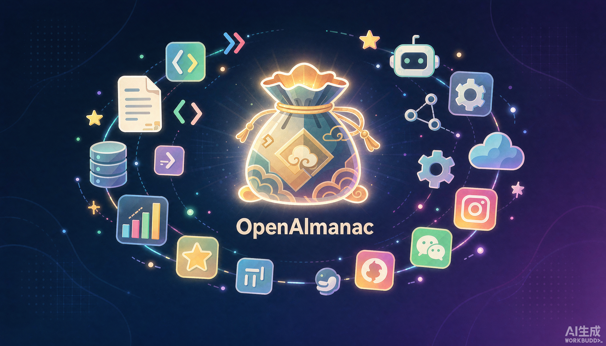
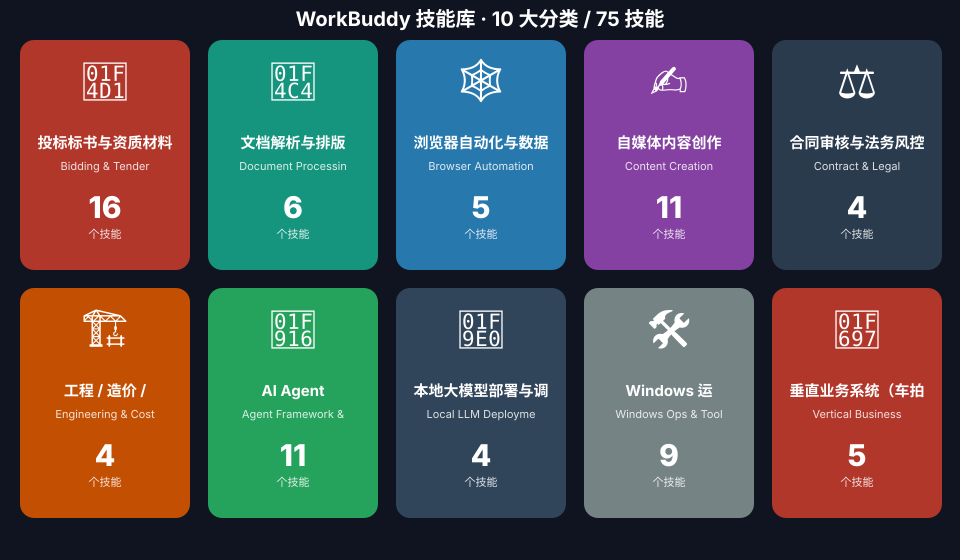

# 👝 WorkBuddy 技能库（乾坤袋）

> **75 个开箱即用的 AI Agent 技能，覆盖投标标书 / 自媒体运营 / 合同法务 / 工程造价 / 本地大模型 / Windows 运维等 10 大场景。**
> 全部为中文实战技能，放进 WorkBuddy 即可对话触发。由武汉宏刚行科技 · 叶徐刚 维护。

<p align="center">
  
</p>

<p align="center">
  
  
  
  
  
  
</p>

---

## 📚 这是什么

[WorkBuddy](https://www.workbuddy.cn) / CodeBuddy 的「技能（Skill）」本质是一份带触发规则与工作流说明的 `SKILL.md`，
让 AI 在合适的场景自动加载专家级 SOP。本仓库是我（叶徐刚）过去一年沉淀的 **75 个技能**，
按用途分为 **10 大类**，从政府采购投标到公众号/小红书自动化，从合同审查到本地大模型部署，全部为真实业务打磨。

- ✅ **即拷即用**：把技能文件夹复制到 `~/.workbuddy/skills/` 即可，无需改代码
- ✅ **中文优先**：技能指令、提示、UI 文案均为简体中文
- ✅ **实战导向**：每个技能都来自真实项目，不是玩具 demo
- ✅ **已脱敏**：公开前已剔除所有明文密码 / 服务器 IP / 个人隐私

<p align="center">
  
</p>

## 🗂️ 分类总览（10 类 / 75 技能）

| 图标 | 分类 | 技能数 | 一句话 |
| --- | --- | --- | --- |
| 📑 | [投标标书与资质材料](categories/01-bidding-tender/README.md) · `Bidding & Tender` | 16 | 从招标文件解析、技术方案主观分撰写、废标审查到价格分析、软著材料，覆… |
| 📄 | [文档解析与排版](categories/02-document-processing/README.md) · `Document Processing` | 6 | 文档转 Markdown、纯离线抽取、标书页码回填、方案排版、OCR… |
| 🕸️ | [浏览器自动化与数据采集](categories/03-browser-crawling/README.md) · `Browser Automation & Crawling` | 5 | AI 驱动的浏览器自动化、可复用技能锻造、反爬网页抓取、小红书作品采… |
| ✍️ | [自媒体内容创作](categories/04-content-creation/README.md) · `Content Creation` | 11 | 微信公众号（写作/封面/搜索/10w+热榜/每日自动化）、小红书（写… |
| ⚖️ | [合同审核与法务风控](categories/05-contract-legal/README.md) · `Contract & Legal` | 4 | 合同智囊、AI 合同风控官、OpenClaw 合同审核、全能型法律审… |
| 🏗️ | [工程 / 造价 / CAD](categories/06-engineering-cost/README.md) · `Engineering & Cost` | 4 | 工程造价审计（5 角色）、工程结算报审风险防控、工程设计问题审查闭环… |
| 🤖 | [AI Agent 框架 / 自进化 / 分析](categories/07-agent-framework/README.md) · `Agent Framework & Self-Evolution` | 11 | 自我进化范式、多 Agent 编排、达尔文优化、技能补建、LLM 维… |
| 🧠 | [本地大模型部署与调用](categories/08-local-llm/README.md) · `Local LLM Deployment` | 4 | Windows 本地 GPU 部署、Ollama 多模型自动网关、超… |
| 🛠️ | [Windows 运维与 WorkBuddy 工具链](categories/09-windows-ops/README.md) · `Windows Ops & Toolchain` | 9 | 管理员权限诊断、开机自启清理、Git Bash 修复、解除程序黑名单… |
| 🚗 | [垂直业务系统（车拍拍 / 物损驾驶舱）](categories/10-vertical-systems/README.md) · `Vertical Business Systems` | 5 | 车拍拍车辆拍卖平台运维/排障/模板修复，物损拍卖商务驾驶舱大屏与规范… |

> 点分类名可进入该分类的详细 README（含每个技能的触发词与简介）。

## 🚀 快速开始

<p align="center">
  
</p>

**方式一：安装单个技能（推荐）**

```bash
# 1. 克隆本仓库
git clone https://github.com/yehuzi2026/workbuddy-skills-hub.git
# 2. 把某个技能文件夹复制到 WorkBuddy 用户级技能目录
#    Windows:
xcopy workbuddy-skills-hub\categories\01-bidding-tender\投标全流程编排-小羊羊  %USERPROFILE%\.workbuddy\skills\投标全流程编排-小羊羊\
#    macOS / Linux:
cp -r workbuddy-skills-hub/categories/01-bidding-tender/投标全流程编排-小羊羊  ~/.workbuddy/skills/
# 3. 重启 WorkBuddy，对话里说「我要做标书」即可触发
```

**方式二：一键安装整个分类**

```bash
cp -r workbuddy-skills-hub/categories/04-content-creation/*  ~/.workbuddy/skills/
```

> 技能目录位置：Windows `C:\Users\<你>\.workbuddy\skills\`；macOS/Linux `~/.workbuddy/skills/`

## 🌟 精品推荐（旗舰技能）

- **📑 投标全流程编排-小羊羊** —— 说一句「我要做标书」即可拉起投标全链路：解析招标文 → 写技术方案主观分 → 废标审查 → 排版出 PDF。
- **📑 小羊羊AI投标文件废标项审查** —— 十年评审经验固化，逐字符 diff、强制事前清单，专门帮你在交标前排雷。
- **✍️ wechat-article-pro** —— 联网搜热点 + AI 写 3000-5000 字深度文 + 自动生成封面 + 排版 + 发布公众号。
- **🧠 local-llm-gpu-deploy** —— Windows 本地把大模型用 GPU 跑起来并接入 WorkBuddy 的完整踩坑手册。
- **🕸️ browser-act** —— 给 AI 用的浏览器自动化 CLI，填表、爬数据、截图、E2E 测试一把梭。

## 🔒 安全与隐私

公开前已对仓库做全量扫描与脱敏：

- 已剔除明文 FTP 密码、阿里云服务器公网 IP、个人邮箱等敏感信息（替换为 `<占位符>`）
- 技能中涉及的第三方 API Key 在本仓库内均为 `ak_xxxx` / `sk-xxxx` 占位示例，真实密钥请通过环境变量注入
- 若你发现仍有遗漏，欢迎在 Issue 中指出

## 📜 许可证与出处

- 本仓库中**由本人原创**的技能以 **MIT 许可证** 开源（见 [LICENSE](LICENSE)）。
- 名称带 `__skillhub` 后缀的技能来自 WorkBuddy SkillHub 市场，版权归原作者所有，本仓库仅作聚合分发，使用时请遵循其上游许可。
- 第三方技能的上游维护者联系方式已在发布时做模糊化处理，详见 [PROVENANCE.md](PROVENANCE.md)。

## 🤝 一起共建

欢迎提交新技能、改进现有技能、补充示例！详见 [CONTRIBUTING.md](CONTRIBUTING.md)。
也欢迎把自己打磨的 Skill 通过 PR 合入，让中文 AI Agent 生态更好用。

## 📮 联系我

- **维护者**：叶徐刚（乾坤袋）
- **公司**：武汉宏刚行科技发展有限公司
- **邮箱**：86264723@qq.com
- **公众号**：初心杂谈的碎碎念
- **GitHub**：[@yehuzi2026](https://github.com/yehuzi2026)

> 如果你在做 AI Agent / 投标 / 自媒体自动化 / 本地大模型相关的事，欢迎来撩，或许能碰撞出好玩的合作 🤝

---

⭐ 如果本仓库对你有帮助，点个 Star 是对我最大的鼓励！
